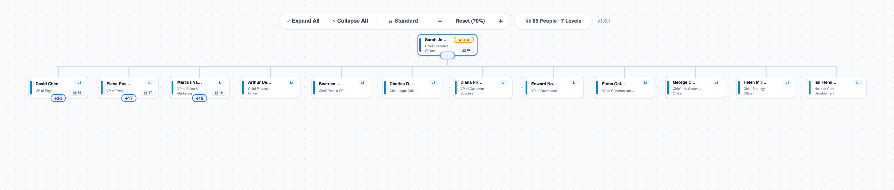
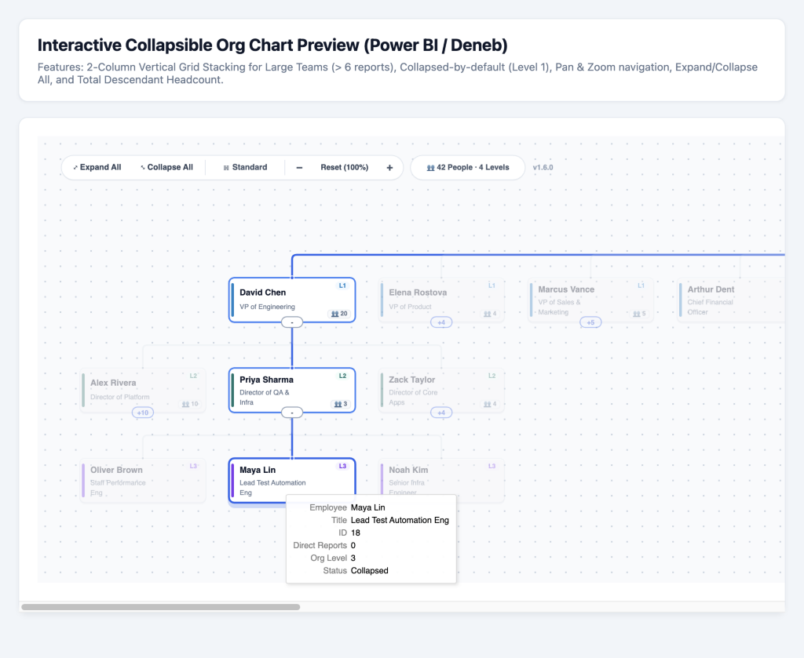
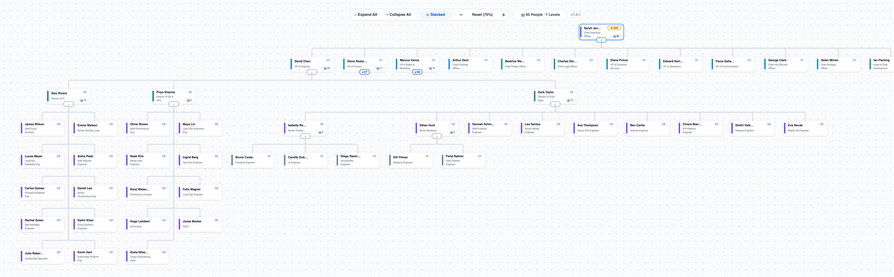

# Power BI Interactive Collapsible Org Chart (Deneb & Vega)

An interactive **Collapsible Organizational Chart** for Power BI built with the **Deneb** custom visual (Vega 5).

The goal is to cleanly visualize organizations with 1,000+ employees—with zero overlapping cards, smooth pan & zoom, and one-click branch collapsing.

> **[🚀 Open Live Interactive Demo](https://brunoo.github.io/powerbi-deneb-org-chart/)** *(powered by GitHub Pages — click to expand, collapse, hover, pan, and zoom live in your browser)*

---

## 📸 Preview

### Executive Overview (12 Direct Reports, Standard Mode)


### Active Reporting-Line Highlighting & 2-Line Title Wrapping


### Compact 2-Column Stacking (Stacked Mode)


---

## ✨ Features

- **Clean Executive Design & Division Color Coding**: Rounded cards on a subtle dot-grid canvas with alternating level bands, smooth curved branch connectors, and automatic per-division HSL color tinting based on each employee's Level-1 leader.
- **Unlimited Hierarchy Depth**: Uses Vega's `treeAncestors()` to compute depths, headcounts, and lineage across organizations of any depth.
- **2-Line Title Wrapping**: Long job titles wrap onto a second line at word boundaries instead of being cut off with `...`.
- **Rich Hover Tooltips with Direct Manager, Reporting Line & Extra Metadata**: Hovering any card reveals full employee details including job title, **Direct Manager** (omitted for the CEO), full bottom-up **Reporting Line** to the CEO (`rawDepth > 1`), any mapped **Extra 1 / 2 / 3** metadata (full untruncated text), direct report headcount, and organization level (plus optional employee ID).
- **Total Team Headcount (`👥 N`)**: Every manager card displays its total downstream headcount.
- **Active Reporting-Line Highlighting & Branch Focus Mode**: Hover over any employee to highlight their full management chain up to the CEO and all reports. Single-click any card to lock **Branch Focus Mode** (highlights lineage and adds a 3px focus ring without moving the view). Double-click any card to **Fit & Center** its branch. Click empty canvas or Reset to exit focus.
- **Interactive Branch Collapse & Expand**: Click **`−`** on any manager card to collapse their team, or **`+N`** to expand it again. The clicked node stays pinned exactly where it is (pan compensates for the re-layout); drag, Fit, reset, Collapse All, or clicking any card to release it.
- **Floating Toolbar & Live Summary**:
  - **`⤢ Expand All`** / **`⤡ Collapse All`** for instant tree-wide control. Double-click any card to zoom-to-fit and center its branch. **`Filter: All`** floating pill cycles distinct `Extra 2` values, keeping only matches plus their management chain (hides automatically when `Extra 2` is unmapped).
  - **`☵ Standard` / `⊞ Compact`** toggle (starts in `Compact`) to switch between the standard horizontal tree and `Compact` mode—which scales large leaf teams (`> 6` direct reports) up to 2/4/6/8 columns *and* pairs wide horizontal bands onto 2 alternating sub-rows (~50% width). Stacked teams hang off a central spine from their **real manager**, so every connector always points to the correct boss.
  - **`[ − | Reset (100%) | + | Fit ]`** zoom controls, plus cursor-anchored mouse-wheel zoom, drag-anywhere panning, double-click canvas background to reset, and touch pinch-to-zoom.
  - **Live Summary Pill** showing total headcount and hierarchy depth (e.g., `👥 85 People · 7 Levels`).
- **On-Canvas Gesture Hint**: A subtle caption under the toolbar reminds viewers of the essentials — click card to focus, double-click card to center branch, double-click canvas to reset (dynamically updates when in Branch Focus Mode).
- **Collapsed by Default**: Opens with just the CEO and Level-1 leaders visible so large organizations load quickly without visual clutter.

---

## 📁 Files

- [`deneb-org-chart.json`](./deneb-org-chart.json): Ready-to-use Vega 5 specification (`v1.10.0`) to paste into Deneb in Power BI.
- [`sample-org-data.csv`](./sample-org-data.csv): Sample dataset (85 employees across 7 levels) that exercises every layout edge case: a 12-person executive team, leaf-only teams that stack (even and odd sizes, side-by-side, at Level 6), a large *mixed* team of managers and engineers (stays horizontal), a team exactly at the threshold, IDs that cross digit boundaries (`17` vs `100` vs `1000`) in shuffled input order, and `Extra 2` office cohorts (`Paris`/`London`/`New York`) scattered across teams to exercise filtering.
- [`preview.html`](./preview.html) & [`index.html`](./index.html): Standalone HTML preview for testing in any browser (no Power BI needed; requires internet for the Vega CDN).
- [`tools/verify-layout.js`](./tools/verify-layout.js): Automated layout checker (see [Development](#-development--layout-verification)).

---

## 🚀 Step-by-Step Power BI Setup

### 1. Install Deneb
1. Open **Power BI Desktop**.
2. In the **Visualizations** pane, click **`...`** → **Get more visuals**.
3. Search for **Deneb, Declarative Visualization in Power BI** (Microsoft-certified) and click **Add**.

### 2. Prepare Your Data Table
Your table must contain columns named **exactly** `ID`, `ParentID`, `Name`, and `Title` — Deneb passes columns by name, so these names are not optional:

| Column | Type | Description | Example |
| :--- | :--- | :--- | :--- |
| **`ID`** | Text or Whole Number | Unique identifier for each employee | `1`, `"E101"` |
| **`ParentID`** | Text or Whole Number | Direct manager's ID (**must be empty/`null` for the CEO**) | `null`, `1` |
| **`Name`** | Text | Employee's full name | `Sarah Jenkins` |
| **`Title`** | Text | Employee's job title | `Chief Executive Officer` |

**Rename your columns in Power Query** (exact clicks — do this even if your data already looks right):
1. In Power BI Desktop: **Home** → **Transform data** (opens the Power Query editor).
2. Select your employee table in the left-hand **Queries** list.
3. Right-click each relevant column header → **Rename**, and type exactly `ID`, `ParentID`, `Name`, `Title` (spelling *and* capitals matter).
4. Give `ID` and `ParentID` the **same data type**: select both columns (hold **Ctrl**), then **Transform** → **Data Type** → **Text** is the safest choice — it also supports IDs like `"E101"`.
5. The CEO's `ParentID` cell must be **empty/`null`**. If it shows `0`, clear it — but note `0` is treated as "no manager" everywhere, so a real employee must also never have `ID` `0`.
6. Top-left: **Close & Apply** to return to Power BI.

**Optional extra card lines:** to show up to 3 extra lines on every card (e.g. location, department), add columns named exactly **`Extra 1`**, **`Extra 2`**, **`Extra 3`** — in Power Query via **Add Column** → **Custom Column**, or by renaming existing columns as above. Values must be short single-line text (longer values are truncated with `…`). All cards adopt the height of the fullest card — see [Limitations](#️-limitations--data-prerequisites).

> [!IMPORTANT]
> **Hierarchy Requirements:**
> 1. **Single Root**: Exactly one person (the CEO/top leader) must have a blank/`null` `ParentID`.
> 2. **No Orphans**: Every non-blank `ParentID` must match an existing `ID` in the table.
> 3. **No Loops**: An employee cannot report to someone who reports back to them.

### 3. Add Fields to Deneb
1. Add a **Deneb** visual to your report page.
2. Drag **`ID`**, **`ParentID`**, **`Name`**, and **`Title`** into Deneb's **Values** data role (plus `Extra 1`–`Extra 3` if you created them).
3. For **each** field in the data role: click its **`∨`** dropdown → set summarization to **Don't summarize**. This is the #1 novice mistake — if Power BI sums or counts your IDs you will get one giant card or nonsense groupings instead of one card per person. Repeat for numeric *and* text fields.

### 4. Paste the Specification
1. Click **`...`** in the top-right corner of the Deneb visual → **Edit**.
2. Choose **Vega** *(not Vega-Lite)*, select **[empty]**, and click **Create**.
3. Replace the editor contents with [`deneb-org-chart.json`](./deneb-org-chart.json).
4. Click **Apply** (**Ctrl + Enter**), then **< Back to report**.

### 5. Change the Default Settings (Optional)
Settings live in the `signals` block at the top of the pasted spec. Exact steps:
1. Click **`...`** on the Deneb visual → **Edit** to reopen the spec editor.
2. Press **Ctrl + F**, type the setting name (e.g. `defaultCollapseDepth`), and change only its `"value"`.
3. Click **Apply** (**Ctrl + Enter**), then **< Back to report**.

Common recipes:
- **Start fully expanded:** `"name": "defaultCollapseDepth", "value": 1` → `"value": 99`.
- **Start in the standard horizontal tree:** `"name": "layoutMode", "value": "compact"` → `"value": "standard"`.
- **Show employee IDs in tooltips:** `"name": "showIdInTooltip", "value": false` → `"value": true` (keep `false`: IDs can be confidential).
- **Stack smaller teams too:** `"name": "gridThreshold", "value": 6` → `"value": 4`, for example.

### 6. If Something Looks Wrong
| Symptom | Most likely cause → fix |
| :--- | :--- |
| Blank visual, only the toolbar | No CEO found: some row must have an empty `ParentID` (see Step 2.5). Or a reporting loop alongside a valid root — see [Limitations](#️-limitations--data-prerequisites) rule 4. |
| One giant card, or nonsense cards | Summarization is on: redo Step 3.3 — **Don't summarize** on *every* field in the **Values** data role. |
| People attached to the wrong boss | Orphan `ParentID` (no matching `ID`) or duplicate `ID`s — the visual re-attaches strays under the root instead of crashing, so fix the data (see Limitations rules 1–3). |
| "No data to display" message | The visual received zero rows: check the Deneb field mappings and any report-page or RLS filters. |

---

## ⚙️ Optional Configuration

You can adjust default behavior by editing the `signals` block at the top of [`deneb-org-chart.json`](./deneb-org-chart.json):

| Setting | Default | What It Controls |
| :--- | :---: | :--- |
| **`defaultCollapseDepth`** | `1` | Levels shown on initial load (`1` = CEO + Level-1 VPs; `2` = down to Directors; `99` = expand all). |
| **`layoutMode`** | `'compact'` | Starting layout mode (`'standard'` or `'compact'`). Users can toggle live in the toolbar (`☵ Standard` / `⊞ Compact`). |
| **`gridThreshold`** | `6` | A team stacks into 2 columns when it has more direct reports than this **and none of them are managers** (mixed teams stay horizontal so peers never share a row with a colleague's reports). |
| **`stackMinDepth`** | `2` | Keeps top executives (Level 1) horizontal even when stacking is enabled. |
| **`zoomLevel`** | `1.0` | Starting zoom level (`0.4` to `1.6`). |
| **`showIdInTooltip`** | `false` | Show employee `ID` in the card hover tooltip (keep `false`: IDs can be confidential). |
| **`showReportingLineInTooltip`** | `true` | Show full bottom-up line of managers up to the CEO in the card hover tooltip (`rawDepth > 1`). |
| **`extraFilterIdx`** | `-1` | Selected `Extra 2` filter by rank (`-1` = All). Prefer the toolbar `Filter` button; only hand-edit to lock a report to one value. |

---

## ⚠️ Limitations & Data Prerequisites

Check these before publishing — the visual sanitizes sloppy inputs where it can, but a few cases still need clean data:

| # | Rule | What happens if you break it |
| :--- | :--- | :--- |
| 1 | **IDs must be unique and non-blank.** | The first occurrence wins; duplicates are dropped silently. |
| 2 | **Do not use `0` as an employee ID.** | `ParentID` `0` / `'0'` is treated as "no manager" (the common Power BI root sentinel), so a real `ID` of `0` would misattach its reports. |
| 3 | **Exactly one blank-`ParentID` root is supported.** | Orphan `ParentID`s (no matching `ID`) and extra roots are tolerated — they are attached under the elected root instead of erroring — but the layout verifier enforces a single root, so treat multiples as data to fix. |
| 4 | **No reporting loops.** | A dataset with *no* root at all (pure cycle, e.g. `A↔B`) renders via fallback-root election, but a loop in one branch *alongside* a valid root still breaks the visual. Validate with `node tools/verify-layout.js your-data.csv` before publishing. |
| 5 | **Exotic ID formats only affect sibling order.** | Numeric IDs over 15 digits, negatives, or scientific notation (e.g. `1e3`) still draw a correct hierarchy; only the left-to-right order of siblings may differ from numeric order — deterministically (same data, same layout). Comma-containing text IDs are fully supported. |
| 6 | **Touch devices get no reporting-line highlight.** | Hover highlighting is mouse-driven; tapping a card body focuses and centers its branch, while tapping the **+ / −** pill toggles collapse. Touch pan/pinch/zoom gestures are provided on a best-effort, provisional basis and have **not been tested by the author** — please report anything that misbehaves. |
| 7 | **Toolbar background ignores pan/zoom gestures (by design).** | Dragging, wheeling, or double-clicking on the toolbar background does nothing — start those gestures on the canvas or a card. This keeps the toolbar click-stable so a missed button click can't accidentally pan or zoom the chart. |
| 8 | **Extra card lines need exact column names and stay short.** | Add columns named exactly `Extra 1`, `Extra 2`, `Extra 3` (rename in Power Query if needed); values must be short single-line text — longer values are truncated with `…`. All cards adopt the height of the fullest card (max 3 lines); cards with fewer lines show whitespace instead. |
| 9 | **Filtering keeps the chain, not the team.** | The `Filter` button (fixed on `Extra 2`) hides everything except matches plus their ancestors up to the root, so reporting lines stay true. A matching manager's non-matching reports are hidden too. The summary pill still shows whole-org totals. |

---

## 🧪 Development & Layout Verification

The repository ships a headless checker that renders the spec with Vega in Standard and Compact modes (collapsed, fully expanded, and at several zoom levels, including 50-report stress tests) and fails if the chart becomes ambiguous:

- every connector must go from an employee's **real manager** to the employee (no peer-to-peer chains), and every visible reporting line must be drawn exactly once;
- no connector may pass through an unrelated card, no two managers' connector segments may overlap, and no cards may overlap;
- stacked teams must be leaf-only, above the threshold, and laid out in 2 aligned columns in numeric-aware ID order;
- hovering any card must highlight exactly its reporting chain (and its own reports);
- `preview.html` must embed the same spec as `deneb-org-chart.json`.

```bash
npm install                                  # once (installs vega)
npm test                                     # verify the built-in sample data
node tools/verify-layout.js my-org.csv       # verify your own ID,ParentID,Name,Title export
npm run sync-preview                         # copy deneb-org-chart.json into preview.html after editing
```

> [!NOTE]
> `npm run sync-preview` and the `preview.html` sync check locate the embedded spec by string matching (`const spec = ` … `\n};`). Do not reformat or move that block in `preview.html` — edit `deneb-org-chart.json` and re-run the sync instead. Note that `node tools/verify-layout.js your-data.csv` validates your data but skips the `preview.html` sync check; run plain `npm test` to include it.

---

## 🔒 Security & Row-Level Security (RLS)

- **Certified & Sandboxed**: Deneb is a Microsoft-certified Power BI visual. It runs in an isolated sandbox with zero external network calls or data exfiltration.
- **Safe Text Rendering**: Names and titles are rendered purely as text, preventing HTML/script injection.
- **Row-Level Security (RLS)**: Power BI RLS filters are automatically respected.
  > [!WARNING]
  > Make sure RLS rules do not hide an intermediate manager while leaving their subordinates visible, as every visible employee needs an unbroken path up to the root node.

---

## 🤖 Use of AI

This software was built almost entirely using automated code-generation tools. No human has fully reviewed the generated code for correctness or security. I have extensively tested the visual and use it daily, but there might be issues that I haven't encountered yet.

---

## 🙌 Credits

- Inspired in part by **Davide Bacci**'s [Organisation Tree Chart](https://github.com/PBI-David/Deneb-Showcase/tree/main/Organisation%20Tree%20Chart) in `PBI-David/Deneb-Showcase` (MIT License) for cursor-anchored pan/zoom patterns, `treeAncestors()` lineage calculation, and `hsl()` branch color tinting.

---

## 📄 License

Licensed under the MIT License — see [`LICENSE`](./LICENSE) for details.
